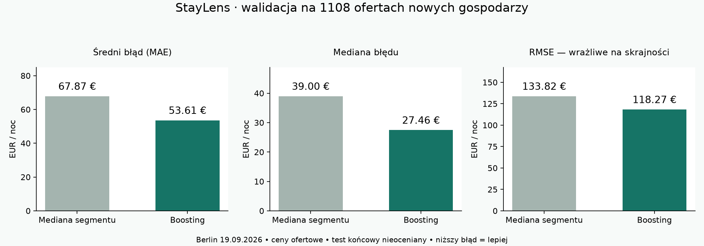

# S02 — porównanie modeli StayLens

Wykonano 28.10.2026. Wybrany model: **HistGradientBoostingRegressor**. Zmniejszył średni błąd walidacyjny o **21,0%** względem mediany segmentów i spełnił wszystkie cztery warunki zamrożonego protokołu. Jest to wynik rozwojowy; końcowy test nie został oceniony.

## Dane i protokół

- Inside Airbnb, Berlin, snapshot 19.09.2026, ceny ofertowe za noc w EUR.
- Trening: **5814 ofert / 3114 gospodarzy**. Walidacja: **1108 ofert / 680 gospodarzy**.
- Gospodarze train i validation nie przecinają się. Test (1235 ofert według preflight S01) pozostaje odłożony. Loader odrzuca grupy testowe przed analizą ceny i cech; sam odczyt pliku źródłowego nie oznacza oceny testu.
- Trzy podziały GroupKFold wewnątrz train; wszystkie transformacje i mediany dopasowywane osobno w danym podziale. Wyniki zbiorcze CV liczone z przewidywań dla każdej oferty wyłącznie w podziale, w którym nie uczestniczyła w treningu.
- Jeden kandydat, bez przeszukiwania parametrów. Ustawienia i kryteria wyboru zapisano przed treningiem w [protokole](../../configs/s02_protocol.json); hash oraz wersje środowiska są w [comparison.json](comparison.json).
- Nie usuwano drogich ofert na podstawie błędów. Trening obejmuje ceny 12,86–10 025 EUR; mediana 129,57 EUR. Filtr dodatniej ceny pochodzi z S01, a nie z wyników modelu.

## Co porównano

**Mediana segmentu:** dzielnica × typ pokoju × przedział liczby gości. Co najmniej 10 przykładów; przy mniejszej grupie przejście do szerszego segmentu, a ostatecznie do mediany całego train. Nie oblicza median na ocenianych danych.

**Boosting:** 250 iteracji, learning rate 0,05, najwyżej 15 liści, głębokość 6, minimum 30 przykładów w liściu, L2=10, strata absolute_error, seed 42. Brak losowego podziału do early stopping; wyłączone. Cel w EUR bez transformacji logarytmicznej. Drzewa obsługują braki numeryczne. OrdinalEncoder uczony w każdym podziale, nieznane kategorie traktowane jak braki, rozgałęzienia kategorialne natywne.

**18 cech:** dzielnica, typ pokoju, typ nieruchomości, współrzędne, liczba gości/sypialni/łóżek/łazienek, minimalna długość pobytu oraz 8 flag udogodnień: Wi-Fi, kuchnia, pralka, klimatyzacja, winda, parking, miejsce do pracy, samodzielne zameldowanie.

Cena, identyfikatory, teksty ofert, opinie, oceny, dostępność i szacunki przychodów nie są wejściami modelu. Nie używamy płatnego API ani tłumaczenia.

## Wynik na walidacji — 1108 ofert

| Miara | Mediana segmentu | Boosting |
| --- | ---: | ---: |
| MAE — średni błąd bezwzględny | 67,87 EUR | **53,61 EUR** |
| Mediana błędu bezwzględnego | 39,00 EUR | **27,46 EUR** |
| RMSE — większa kara za duże błędy | 133,82 EUR | **118,27 EUR** |
| Przewidywania z błędem do 30 EUR | 40,4% | **52,8%** |
| Przewidywania z błędem do 20% rzeczywistej ceny | 32,9% | **44,7%** |
| 90. percentyl błędu bezwzględnego | 129,62 EUR | **104,76 EUR** |

Praktycznie: połowa przewidywań boostingu ma błąd do około 27,46 EUR. Średnia 53,61 EUR jest wyższa przez drogie oferty i duże pomyłki. **MAE nie jest przedziałem „cena ± 53,61 EUR”**, a odsetki mieszczące się w tolerancji nie są accuracy klasyfikatora.

## Czy poprawa utrzymuje się w innych podziałach?

| MAE w EUR | Mediana segmentu | Boosting |
| --- | ---: | ---: |
| CV 1 — 1799 ofert | 70,50 | **56,84** |
| CV 2 — 1997 ofert | 67,21 | **49,46** |
| CV 3 — 2018 ofert | 70,11 | **58,57** |
| CV zbiorczo — 5814 ofert | 69,23 | **54,90** |
| Trening, wynik na własnych danych | 66,69 | 47,94 |
| Osobna walidacja | 67,87 | **53,61** |

Boosting wygrywa w każdym podziale. Błąd treningowy 47,94 EUR jest niższy niż CV 54,90 EUR, więc pewna luka generalizacji istnieje. Zbieżność CV i walidacji jest dobrym sygnałem, ale **nie dowodzi braku overfittingu** ani przenoszalności na inne miasta i daty. Duże różnice RMSE między podziałami są skutkiem skrajnych cen, zachowanych w ocenie.

Bootstrap parami, losujący całych gospodarzy walidacji (1000 powtórzeń, seed 42): 95% przedział dla redukcji MAE wynosi **17,2–25,6%**, czyli **11,59–17,22 EUR**. Dotyczy stabilności porównania w tej próbie, nie pewności ceny konkretnego mieszkania. Nie uwzględnia zmiany rynku w czasie.

## Gdzie model pomaga, a gdzie zawodzi?

| Typ noclegu | Liczba ofert | MAE mediany | MAE boostingu |
| --- | ---: | ---: | ---: |
| Całe mieszkanie/dom | 798 | 79,72 EUR | **62,22 EUR** |
| Prywatny pokój | 298 | 34,68 EUR | **29,36 EUR** |
| Pokój hotelowy | 8 | 138,61 EUR | 112,68 EUR |
| Pokój współdzielony | 4 | 35,60 EUR | 23,74 EUR |

Próby hotelowe i współdzielone są zbyt małe do mocnych wniosków. W hotelach RMSE nawet wzrósł: 206,30 → 234,48 EUR. Wynik ogólny nie oznacza poprawy każdej miary w każdym segmencie.

| Rzeczywista cena oferty | Liczba | MAE mediany | MAE boostingu |
| --- | ---: | ---: | ---: |
| Do 100 EUR | 417 | 39,48 EUR | **21,24 EUR** |
| Powyżej 100 do 200 EUR | 421 | 38,98 EUR | **33,38 EUR** |
| Powyżej 200 do 400 EUR | 209 | 83,01 EUR | **70,38 EUR** |
| Powyżej 400 EUR | 61 | 409,60 EUR | **357,11 EUR** |

To analiza według znanej ceny po ocenie, a nie dostępna z góry reguła kwalifikowania nowej oferty. Dla drogich/luksusowych ofert model nie daje wiarygodnej dokładnej wyceny. Cel to orientacyjny punkt odniesienia; nie wolno nazywać różnicy względem modelu gwarantowaną okazją, oszczędnością ani zyskiem.

Wyniki dzielnic oraz liczby braków są w [pełnym raporcie JSON](comparison.json).

## Audyt cech

Numeryczne `bathrooms` było puste we wszystkich 5814 rekordach train. Deterministyczny parser `bathrooms_text` odzyskał 5810 wartości, w tym „1.5 shared baths” i „Shared half-bath”. Zostały 4 braki. Inne braki: sypialnie 6, łóżka 178, minimalna liczba nocy 96. Brak informacji o udogodnieniu odróżniamy od jawnej nieobecności.

W train są 281 powtórzenia kompletu cech ponad pierwsze wystąpienia. Dwie oferty walidacyjne mają komplet cech identyczny jak w train, mimo rozdzielenia gospodarzy. To nie potwierdza tożsamości nieruchomości. Dodatkowa kontrola bez tych dwóch wierszy: MAE mediany **67,93 EUR**, boostingu **53,64 EUR**. Głównych wyników i decyzji nie zmieniano; te dwa wiersze nie wyjaśniają poprawy. Pełny audyt: [feature_audit.json](feature_audit.json).

## API i sprawdzenia

- Zapisano oba modele; API ładuje wybrany model raz przy starcie. SHA256, kontrakt cech i wersje bibliotek sprawdzane przed deserializacją. Artefakty tylko z zaufanego procesu projektu, bez uploadu modeli od użytkowników.
- Działają `/health`, `/api/model`, `/api/schema`, `/api/predict`, `/docs`, `/openapi.json`.
- 27 testów: odzyskiwanie cech, brak przecieku targetu, fallback median, metryki i selekcja, zgodność API z modelem offline, błędne wejścia, nieznane kategorie i braki, brak fit przy żądaniu, odmowa startu bez modelu/przy błędnej sumie.
- Zgodność zainstalowanych zależności sprawdzona, lint i format poprawne. TestClient emituje ostrzeżenie upstream o planowanym przejściu Starlette z httpx na httpx2; nie jest to błąd wykonania. Zestaw wersji przypięty; produkcyjny endpoint sprawdzono także prawdziwym HTTP bez TestClient.
- Drugie uruchomienie bez zmiany parametrów dało identyczne pliki przewidywań CV i walidacji. Niezależnie przeliczono metryki z zapisanych przewidywań, sprawdzono źródło, grupy i zgodność hashy kodu: [verification.json](verification.json).
- Rzeczywisty lokalny HTTP: poprawna predykcja 200, podanie pola `price` odrzucone 422. Przykładowy profil 2-osobowego mieszkania w Mitte: **181,30 EUR/noc**. To odpowiedź dla przykładu, nie potwierdzenie ceny rynkowej. Dowód: [http_smoke.json](http_smoke.json).

Artefakty binarne i przewidywania z identyfikatorami są w ignorowanym `artifacts/s02-v1/`; raporty, kod, manifest oraz protokół w Git. Odtwarzanie opisano w [API_AND_REPRODUCTION.md](../../docs/API_AND_REPRODUCTION.md). Publikacja wersjonowanego modelu do kontenera/release pozostaje częścią dostawy S04.

## Następny krok — S03

1. Podłączyć frontend do API i dodać formularz parametrów z obsługą braków, błędów oraz schematem kategorii.
2. Zastąpić komunikat „bez modelu” dopiero po rzeczywistej integracji; zachować osobne oznaczenia median i przewidywań ML.
3. Dla istniejących ofert podglądu użyć zapisanych przewidywań **out-of-fold**, żeby oferta i jej gospodarz nie uczestniczyli w treningu modelu, który ją ocenia. Dla nowego profilu formularza używać modelu pełnego train. Oba warianty jasno opisać.
4. Przy cenach ponad 400 EUR pokazać ograniczenie jakości; dla hotelowych/współdzielonych typów informację o małej próbie oceny. Bez etykiet „pewna okazja” i bez fikcyjnych przedziałów pewności.
5. Zachować test końcowy do zamrożenia rozwiązania i odbioru, bez kolejnego strojenia na jego wyniku.

Dokumentacja metod: [HistGradientBoostingRegressor](https://scikit-learn.org/stable/modules/generated/sklearn.ensemble.HistGradientBoostingRegressor.html), [GroupKFold](https://scikit-learn.org/stable/modules/generated/sklearn.model_selection.GroupKFold.html), [FastAPI lifespan](https://fastapi.tiangolo.com/advanced/events/).
