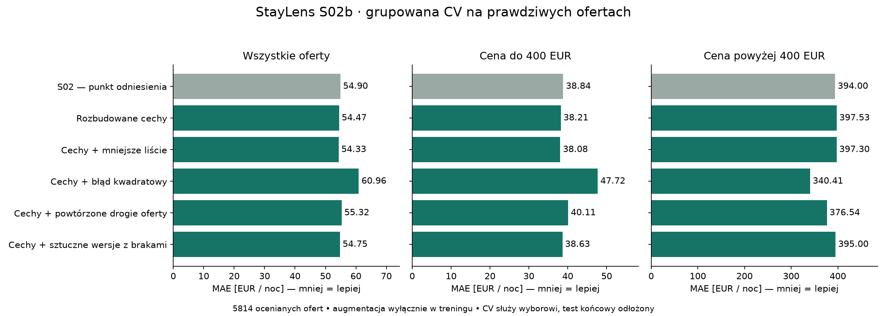

# S02b — data engineering i eksperyment z augmentacją

**Decyzja: zachowujemy model S02. Żaden nowy wariant nie spełnił kryteriów wyboru na CV, dlatego nowych kandydatów nie kierowano do walidacji.** Pole `validation_gate.passed=false` w JSON oznacza brak awansu nowego kandydata, nie odrzucenie istniejącego modelu S02.

Sześć wariantów i warunki wyboru zamrożono przed treningiem. Historyczna walidacja S02 była już wcześniej oglądana; to etap rozwojowy, nie nowy niezależny test. Test końcowy nie został odczytany do oceny.

## Dane i cechy

5814 rzeczywistych ofert treningowych, 3114 gospodarzy. Rozbudowano kontrakt z 18 do 38 cech. Dodano mniejszy obszar miasta, 13 flag udogodnień, informację o wspólnej łazience, proporcje pojemności noclegu, odległość od stałego punktu referencyjnego (52.52, 13.405) i liczbę braków podstawowych cech.

Punkt referencyjny nie jest deklaracją oficjalnego centrum. Odległość to odległość geograficzna, nie czas dojazdu. Dla studia liczba sypialni=0 daje mianownik 1 w proporcji gości; brak pozostaje brakiem. Brak metrażu nie został uzupełniony zmyślonymi wartościami. Nie użyto cen jako cech, tekstów, zdjęć, opinii ani target encodingu.

## Co oznaczają sztuczne dane

Dodatkowy rekord jest niepełną wersją prawdziwej oferty, z ukrytymi około 25% flag udogodnień. Nie zmieniamy ceny, współrzędnych ani liczby pokoi. To trening odporności na brak informacji i zwiększenie wagi rzadkich cen, a nie nowe obserwacje rynku. Każdy rekord ma parent_listing_id, host_id, is_augmented, rodzaj przekształcenia i listę ukrytych pól.

Dla pełnego train powstały 263 dodatkowe wersje z brakami oraz osobny zbiór kontrolny z 263 dokładnymi powtórzeniami drogich ofert. Warianty mają po 6077 wierszy, ale nadal tylko 5814 oryginalnych obserwacji. W CV augmentacja wykonywana osobno PO podziale gospodarzy i wyłącznie z części dopasowania. Wszystkie oceniane rekordy są prawdziwe. Żadne sztuczne rekordy nie trafiają do publicznego katalogu.

## Grupowana walidacja krzyżowa

Każda z 5814 rzeczywistych ofert jest oceniana raz poza grupą dopasowania. Wynik służy wyborowi modelu, więc nie jest bezstronną oceną wybranego zwycięzcy.

| Wariant | MAE wszystkie | MAE do 400 EUR | MAE ponad 400 EUR |
| --- | ---: | ---: | ---: |
| S02 — punkt odniesienia | 54.90 | 38.84 | 394.00 |
| Rozbudowane cechy | 54.47 | 38.21 | 397.53 |
| Cechy + mniejsze liście | 54.33 | 38.08 | 397.30 |
| Cechy + błąd kwadratowy | 60.96 | 47.72 | 340.41 |
| Cechy + powtórzone drogie oferty | 55.32 | 40.11 | 376.54 |
| Cechy + sztuczne wersje z brakami | 54.75 | 38.63 | 395.00 |



## Walidacja wyłącznie wcześniej wybranego kandydata

1108 prawdziwych ofert, 680 gospodarzy; 61 ofert ma cenę ponad 400 EUR. Najpierw zapisano decyzję CV do pliku, dopiero potem załadowano validation. Ponieważ nie wybrano nowego kandydata, sprawdzono jedynie zgodność kontroli S02 z wcześniej zapisanymi przewidywaniami. Żadnego nowego wariantu nie oceniano na validation.

| Wariant | MAE wszystkie | Mediana błędu | RMSE | MAE do 400 EUR | MAE ponad 400 EUR |
| --- | ---: | ---: | ---: | ---: | ---: |
| S02 — punkt odniesienia | 53.61 | 27.46 | 118.27 | 35.93 | 357.11 |

## Interpretacja wyniku

- Same nowe cechy: poprawa ogólnego MAE o około 0,8%, lecz pogorszenie MAE drogich ofert o około 0,9%.
- Nowe cechy i minimum 15 przykładów w liściu: najlepsze ogólne MAE 54,33 EUR (około 1,0% poprawy), ale MAE drogich ofert 397,30 EUR, nieco gorsze od kontroli. Nie spełniono minimum poprawy ani warunku braku pogorszenia drogich ofert.
- Błąd kwadratowy: MAE drogich ofert spadł o około 13,6%, lecz ogólne MAE wzrosło o około 11,0%, a dla ofert do 400 EUR o około 22,9%. Poprawa jednej grupy miała zbyt duży koszt dla większości danych.
- Powtarzanie drogich ofert: MAE drogich spadł około 4,4%, ogólny wzrósł około 0,8%.
- Sztuczne wersje z brakami: MAE ogólne poprawiło się o około 0,3%, a MAE drogich ofert nieznacznie wzrosło. W tym eksperymencie augmentacja nie rozwiązała wskazanego problemu.

Nie zmieniamy progów wyboru po obejrzeniu wyników. Nie oznacza to, że każda metoda augmentacji musi być nieskuteczna. Maskowanie wyłącznie drogich ofert może wprowadzać sztuczny związek między brakami danych a ceną; to dodatkowe ograniczenie badanej metody i powód, by nie wdrażać jej bez dowodów poprawy. Nie badano tu generatywnych modeli danych, interpolacji cen ani rozszerzenia o kolejne prawdziwe snapshoty.

Rozbudowany pipeline i dane zachowano do dalszych badań. Kolejny eksperyment wymaga odrębnego protokołu; priorytetem byłaby dodatkowa rzeczywista informacja o standardzie i powierzchni lub kolejne wiarygodne obserwacje, z kontrolą powtórzeń obiektów i gospodarzy. Aktualna integracja S03 może użyć zweryfikowanego S02 wraz z ograniczeniami cen drogich ofert.

## Kryteria i ograniczenia

Kandydat musi na CV nie pogorszyć MAE ogólnego ani MAE drogich ofert, ograniczyć pogorszenie dla tańszych do 3%, spełnić limity RMSE/mediany błędu i poprawić MAE ogólne co najmniej o 3% lub drogich ofert o 10%. Spośród spełniających warunki wygrywa najniższe MAE ogólne. Bramka validation wymaga m.in. co najmniej 5% poprawy drogich ofert i nie więcej niż 2% pogorszenia MAE ogólnego. Szczegóły: [protokół](../../configs/s02b_protocol.json) i [pełne wyniki](comparison.json).

Sztuczna wersja nie dostarcza niezależnej informacji o nowej cenie. Powtarzanie może zwiększyć przeuczenie i pogorszyć zwykłe oferty; dlatego ocena pozostaje na naturalnym rozkładzie prawdziwych danych. Nie jest to badanie skuteczności wszystkich metod syntetyzacji: badamy konkretną maskowaną augmentację oraz kontrolne powtórzenia.

Cena to historyczna cena ofertowa, nie cena transakcji ani dowód jakości. Segment >400 EUR nie oznacza automatycznie luksusu. Podział gospodarzy ogranicza przeciek, ale nie gwarantuje generalizacji w czasie. Nie generujemy przedziałów pewności ani obietnic okazji. Zachowano skrajne ceny. Wyniki próby hotel/shared pozostają mało pewne.

Dotychczasowy endpoint S02 i jego pliki pozostają zachowane. Nie wdrożono żadnego nowego wariantu. Zapisano pełny model kontrolny, przewidywania CV wszystkich wariantów oraz gotowy kod ich odtwarzania. Formularz S03 nadal może korzystać z kontraktu S02; kontrakt 38 cech pozostaje eksperymentalny.

## Weryfikacja

37 testów przeszło, bez pominięć. Nowe testy obejmują interpretację udogodnień (np. suszarka do włosów nie jest suszarką do ubrań, stół bilardowy nie jest basenem), cechy studia, brak targetu w cechach, pochodzenie i powtarzalność augmentacji oraz odmowę użycia validation/test.

Niezależny skrypt [verify_s02b.py](../../scripts/verify_s02b.py) sprawdził wszystkie 526 dodanych rekordów dwóch osobnych wariantów, oryginalne ceny i współrzędne, dozwolone maskowanie, rozdzielenie gospodarzy w każdym podziale, metryki z zapisanych przewidywań i zgodność decyzji z protokołem. Oceniono zero sztucznych wierszy. Dotychczasowe przewidywania S02 są niezmienione. Wynik: [verification.json](verification.json).

## Odtwarzanie

```powershell
.\.venv\Scripts\python.exe scripts/run_s02b.py
.\.venv\Scripts\python.exe scripts/verify_s02b.py
```

Runner odmawia nadpisania katalogów artefaktów i raportów. Dla powtórzenia podaj nowe --output, --report-dir i --prepared-dir. Źródło i stare wyniki S02 są przypięte hashami; kontrola powtórzyła zapisane przewidywania S02. Wersje, protokół, kod, pochodzenie augmentacji i wybór zapisane w manifestach.

Lokalne pliki: `data/prepared/s02b-v1/real_train.csv`, `train_repeat.csv`, `train_masked.csv`; artefakty w `artifacts/s02b-v1/`. Dane z identyfikatorami pozostają poza Git i publicznym katalogiem. Raporty oraz kod są wersjonowane. Niniejszy raport uzupełniono o interpretację po wygenerowaniu liczb; oryginalny protokół i wyniki JSON zachowano.

Metodyka: [oddzielanie resamplingu od oceny](https://imbalanced-learn.org/stable/common_pitfalls.html), [parametry modelu](https://scikit-learn.org/stable/modules/generated/sklearn.ensemble.HistGradientBoostingRegressor.html). Zasada podziału ma zastosowanie także tutaj; nie używamy SMOTE klasyfikacyjnego do cen i nie instalujemy imbalanced-learn.
