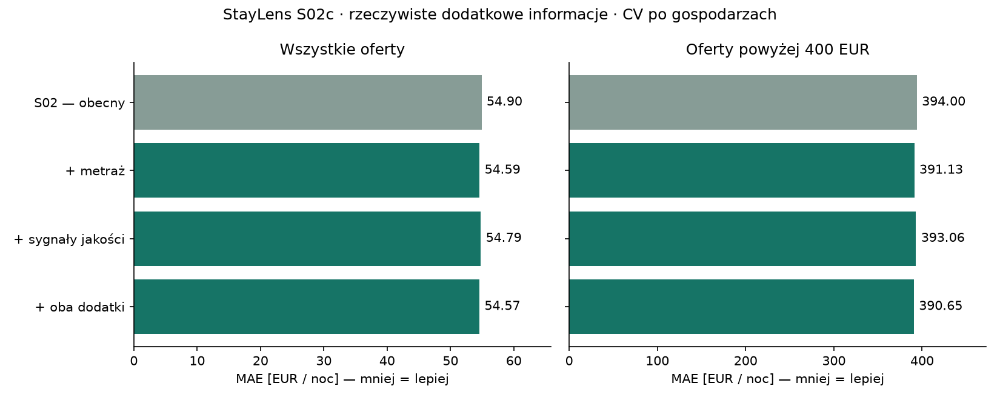

# S02c — prawdziwe dane o metrażu i jakości noclegów

**28.10.2026. Możemy połączyć część nowych danych, ale sprawdzony przyrost jakości modelu jest mały. Zachowujemy S02.** Łączne dodatki obniżyły MAE grupowanej CV z 54,90 do 54,57 EUR (0,61%). Nie spełniają zamrożonego minimum 3% poprawy ogólnej lub 10% dla drogich ofert. Nie oceniano nowych wariantów na validation ani na końcowym teście.

## Znalezione źródła i możliwość połączenia

| Źródło | Co faktycznie sprawdzono | Decyzja |
| --- | --- | --- |
| [Doorstep Analytics — Berlin](https://doorstepanalytics.com/report?country=Germany&location=Berlin) | Pobrany bezpłatny EssentialsPackage 19092026: 5847 rekordów, 69 kolumn, unikalne Airbnb_ListingID, dane z 18–19.09.2026. Guest Favourite i liczba udogodnień dostępności; brak kolumny powierzchni i tekstów opisów w tym pakiecie. | Dokładne połączenie po ID, kontrola gospodarza, daty i cech. Lokalny eksperyment poniżej. |
| [Inside Airbnb](https://insideairbnb.com/get-the-data/) | Nasz przypięty snapshot 19.09.2026 zawiera nazwy i opisy z deklaracjami powierzchni, ale nie osobną kolumnę square_feet/metrażu. | Nowe cechy wyodrębnione z posiadanych danych. To nie jest nowy zewnętrzny pomiar. |
| [AirROI — Berlin](https://www.airroi.com/data-portal/markets/berlin-germany) | Publiczny schemat obejmuje listing_id, opisy, udogodnienia i oceny; w sprawdzonym schemacie brak dedykowanej powierzchni. Dostawca wskazuje licencje akademickie/osobiste zależne od zbioru. | Potencjalne dokładne ID, lecz nie potwierdzono bezpłatnego dostępnego pliku/licencji do integracji. Nic nie kupowano ani nie dodawano do treningu. |
| [Hotelstars — Berlin](https://www.hotelstars.eu/germany/de/hotelsuche/staedte/berlin) | Oficjalna klasyfikacja hotelowa; [zasady](https://www.hotelstars.eu/germany/de/system/faq) opisują dobrowolną klasyfikację i kontrolę obiektów. | Brak zweryfikowanego masowego powiązania z Airbnb listing_id. Gwiazdki obiektu nie określają powierzchni konkretnego pokoju. Nie dołączano po podobnej nazwie lub bliskości. |
| [visitBerlin — Data Hub](https://about.visitberlin.de/digitalisierungsprojekte-2025) | Oficjalny projekt integracji informacji turystycznych. | Nie znaleziono w sprawdzonych materiałach publicznego pliku z metrażami, licencją i kluczem do naszych ofert. Nie wykorzystano. |

Przybliżona lokalizacja nie wystarcza do łączenia budynku z konkretnym apartamentem. Inside Airbnb opisuje przesunięcie współrzędnych do około 150 m i różne przesunięcia ofert z jednego budynku. Metraż budynku z mapy/rejestru nie jest metrażem wynajmowanego lokalu. [Założenia źródła](https://insideairbnb.com/data-assumptions/).

Wyniki indeksu wyszukiwarki pokazywały inne daty raportu Doorstep niż strona pobrana bezpośrednio. Analiza używa dat **wewnątrz pobranego CSV** i przypiętego SHA256, nie daty z wyszukiwarki. To audyt konkretnej wersji, nie wszystkich danych dostawcy.

## Kontrola połączenia — wyłącznie train

Z 5814 naszych ofert 3852 mają dokładny identyfikator w źródle Doorstep. Wszystkie ID wczytano jako tekst, aby nie uszkodzić 19-cyfrowych identyfikatorów konwersją na float.

| Wynik kontroli (rozłączne kategorie) | Oferty |
| --- | ---: |
| Przyjęte po wszystkich kontrolach | 1962 |
| Brak dokładnego ID w drugim źródle | 1962 |
| Inny gospodarz | 105 |
| Sprzeczna liczba gości | 3 |
| Sprzeczna liczba łóżek | 1782 |

Nie zastępowaliśmy oryginalnej liczby łóżek. Częsta zgodność zewnętrznego Beds z Bedrooms sugeruje możliwy problem ekstrakcji, ale to hipoteza, nie potwierdzony błąd dostawcy. Konflikty są odłożone. Same identyczne ID nie wystarczyły do akceptacji. Pozostałe kontrole obejmują typ noclegu, znane sypialnie/łazienki i datę obserwacji nie późniejszą niż last_scraped. Daty porównujemy na poziomie dnia; kolejność wewnątrz dnia pozostaje nieznana.

Wszystkie 5814 oryginalnych ofert pozostały w treningu/ocenie. Przy braku bezpiecznego połączenia nowe pola mają NaN, a nie zero. Żadne zewnętrzne ceny, wskaźniki przychodu, współrzędne, adresy czy nazwy gospodarzy nie trafiły do modelu. Nie dodano nowych wierszy z etykietą ceny.

## Powierzchnia i standard — znaczenie cech

- **667 całych lokali i 118 pokoi**, razem **785 ofert (13,50%)**, otrzymało metraż z własnego tytułu/opisu. Parser rozdziela powierzchnię pokoju i całego lokalu, obsługuje m²/qm/sqm i stopy kwadratowe. Odrzuca zakresy, sumy, konflikty, powierzchnie ogrodów/tarasów oraz niejednoznaczny zakres. Nie szacuje braków z liczby łóżek i nie dodaje wymyślonych m².
- To **deklaracja gospodarza odczytana automatycznie**, nie pomiar zweryfikowany dokumentacją. Język opisów i skróty ograniczają pokrycie. Asystent obejrzał 55 wylosowanych fragmentów zaakceptowanych deklaracji bez cen; nie zauważył oczywistego błędu zakresu w tej próbce. To kontrola robocza, nie niezależna anotacja człowieka ani oszacowanie dokładności parsera. Lokalna próbka: .local/s02c-audit/area_review.csv; pełne ślady: artifacts/s02c-v1/area_evidence_train.csv.
- **Guest Favourite** to wyróżnienie oparte na ocenach, opiniach i niezawodności. Nie są to hotelowe gwiazdki ani obiektywna miara luksusu. Wartość znana dla 1962 ofert: 756 wyróżnionych, 1206 bez wyróżnienia. Nie ma jej dla zupełnie nowych ogłoszeń. [Wyjaśnienie Airbnb](https://www.airbnb.co.uk/help/article/3496).
- Liczba udogodnień dostępności pochodzi z drugiego źródła i nie jest skalą luksusu. W 1920 z 1962 zaakceptowanych rekordów wynosi zero; tylko 42 mają dodatnią wartość. To rzadki sygnał.

Wśród 263 ofert droższych niż 400 EUR metraż znany jest dla 63, a cechy zewnętrzne dla 84. Obie grupy informacji jednocześnie są znane dla 280 ofert w całym train. Braki nie są losowe: szczegółowe opisy oraz zgodność między źródłami mogą dotyczyć innych typów ofert. Wyniki dotyczą tego pokrycia, nie idealnego kompletnego zbioru metraży.

## Eksperyment i wyniki

Przed dopasowaniem zapisano [protokół](../../configs/s02c_protocol.json), reguły parsera, kontroli połączeń i wyboru. Cztery warianty używają tego samego HistGradientBoostingRegressor i jego parametrów z S02. Oryginalne 18 cech rozszerzono o dwa metraże, dwa zewnętrzne sygnały albo oba zestawy. Nie dostrajano parametrów. Brak tekstu, ceny i identyfikatorów w macierzy modelu.

3-fold GroupKFold, ci sami gospodarze i seed co w S02; 5814 realnych ofert ocenionych poza gospodarzem użytym do dopasowania. Kod odtworzył zapisane wcześniej przewidywania kontrolne S02. Wyniki historycznej walidacji były już znane, więc to eksperyment rozwojowy, nie nowe niezależne badanie.

| Wariant | MAE wszystkie, EUR | MAE do 400 EUR | MAE ponad 400 EUR |
| --- | ---: | ---: | ---: |
| S02 — kontrola | 54,90 | 38,84 | 394,00 |
| + metraż z opisów | 54,59 | 38,64 | 391,13 |
| + zewnętrzne sygnały jakości | 54,79 | 38,76 | 393,06 |
| + oba dodatki | **54,57** | 38,65 | **390,65** |



Łączny przyrost: około **0,33 EUR / 0,61%** ogólnie oraz **3,35 EUR / 0,85%** powyżej 400 EUR. Niewielka poprawa występuje we wszystkich trzech foldach, ale nie dowodzi istotnej poprawy poza tym zbiorem. Nie wykonano testu istotności. Brakuje podstaw do przedstawiania tego jako przełomu lub rozwiązania błędu drogich ofert.

Każdy kandydat spełnił limity niepogorszenia, lecz żaden nie osiągnął minimalnej skali korzyści. **Nie awansował do validation.** Zachowano S02, nie zmieniono progów po wynikach. Końcowy test pozostaje odłożony. API i publiczny katalog nie zostały wzbogacone tymi eksperymentalnymi danymi.

## Warunki wykorzystania i odtwarzanie

[Warunki Doorstep](https://doorstepanalytics.com/legal/terms) przypisują darmowym publicznym grafikom, mapom i raportom CC BY-NC-SA 4.0; licencja płatnych danych jest inna. Zakres tego sformułowania dla pobranego surowego CSV nie jest jednoznaczny. Zbiór pozostaje wyłącznie lokalnym materiałem badawczym, poza Git i publicznym katalogiem. Nie określamy go jako danych bez ograniczeń ani nie łączymy jego licencji z CC BY 4.0 Inside Airbnb. Przed publikacją takiego wzbogaconego zbioru lub komercyjnym wykorzystaniem trzeba wyjaśnić zakres praw. Nie wysyłano danych kontaktowych, nie tworzono konta ani nie kupowano pakietu.

Pobrany ZIP: 714566 bajtów; SHA256 `02ad47102440ca7094613c4568b905dd52eaef4446f501adfdb7686e98809dc9`. Zawiera Airbnb_Master_Dataset.csv i Data_Dictionary.xlsx. Żądanie publicznego darmowego formularza utrwalono w skrypcie; hash odrzuci zmieniony plik. Kopie robocze z host_id i fragmentami opisów są ignorowane przez Git.

```powershell
.\.venv\Scripts\python.exe scripts/download_s02c_source.py
.\.venv\Scripts\python.exe scripts/run_s02c.py
.\.venv\Scripts\python.exe scripts/verify_s02c.py
```

Runner odmawia nadpisania istniejących wyników. Do odtworzenia użyj nowych --output i --report-dir. Weryfikator domyślnie sprawdza oryginalny s02c-v1. [Pełne metryki](comparison.json), [manifest](manifest.json), [kontrola](verification.json). 60 testów Python przeszło; pozostało znane ostrzeżenie deprecjacyjne TestClient/httpx.

## Co dalej

Nie opłaca się teraz poszerzać zbioru o przypadkowe mieszkania z portali najmu długoterminowego: inne ceny i brak klucza nie pozwolą przypisać cech do naszych noclegów. Następny eksperyment miałby sens z wiarygodnym źródłem kompletnych powierzchni i standardu dla większej części **tych samych ofert**, zwłaszcza drogich, oraz wyjaśnioną licencją. Nowy zbiór innych noclegów wymagałby własnych porównywalnych cen i odrębnego protokołu.

Przy terminie 03.11 rekomendujemy zakończyć ten ograniczony etap badawczy i przejść do **S03: integracji działającego modelu z aplikacją**, z wyraźną informacją o większym błędzie drogich ofert. Nowe formularze mogą w przyszłości zbierać deklarowany metraż od użytkownika, ale samo dodanie pola nie oznacza, że obecny model je wykorzystuje. Dalsza praca nad cechami nie zastępuje Dockera, CI/CD, Terraform i faktycznego wdrożenia wymaganych na zaliczenie.
