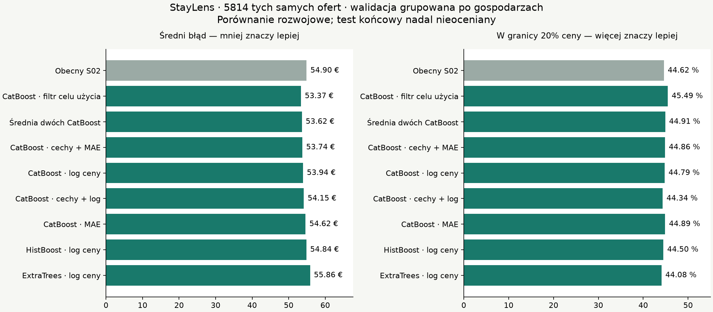
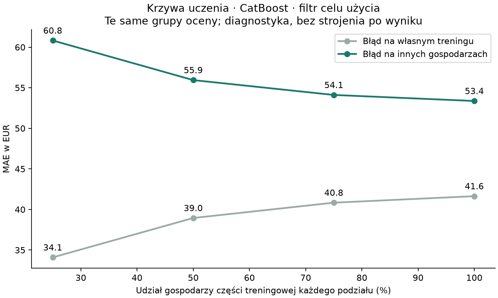

# S03b — audyt celu ofert i porównanie metod

28.10.2026. Użytkownik uznał błąd 53,61 EUR za zbyt duży i zlecił samodzielne poszukanie poprawy. Porównano osiem nowych wariantów z niezmienionym S02. **Żaden nie spełnił ustalonych warunków awansu. Aktywny model pozostaje S02.** To ukończony eksperyment z niewystarczającą poprawą, nie nowa wdrożona wersja.

## Co sprawdzono

Protokół i kod zamrożono w Git **4187c95 przed treningiem**. Ten sam snapshot, 5814 rzeczywistych ofert, 3114 gospodarzy, te same trzy podziały GroupKFold. Nie usuwano trudnych wierszy z oceny, nie zmieniano cen, nie dodawano syntetycznych obserwacji. Odtworzona kontrola S02 dała identyczne przewidywania.

Nowe warianty: CatBoost uczony na błędzie bezwzględnym, CatBoost na logarytmie ceny, oba z pięcioma dodatkowymi cechami wyliczanymi z formularza, wariant pomijający tytuły eventowe/zdjęciowe wyłącznie w treningu, ExtraTrees na logarytmie ceny, HistGradientBoosting na logarytmie i stała średnia dwóch CatBoost. Parametry ustalone przed fit; żadnego strojenia po zobaczeniu wyników. Wszystkie wejścia dostępne w istniejącym formularzu, bez identyfikatorów, tekstów czy opinii w cechach modelu.

Warunki awansu obejmowały minimum 5% redukcji MAE, wzrost trafień w tolerancję 20% ceny o 2 punkty procentowe, poprawę mediany błędu o 2%, ochronę drogich ofert i głównych rodzajów noclegu oraz poprawę w co najmniej dwóch podziałach. Wybrany w CV kandydat miał dopiero przejść osobną bramkę walidacji. Nie obniżano progów po wynikach.

## Wyniki CV

| Wariant | MAE, EUR | Mediana błędu, EUR | Błąd do 20% ceny |
| --- | ---: | ---: | ---: |
| Obecny S02 | 54,90 | 27,58 | 44,62% |
| CatBoost MAE | 54,62 | 28,06 | 44,89% |
| CatBoost log ceny | 53,94 | 27,90 | 44,79% |
| CatBoost dodatkowe cechy + MAE | 53,74 | 27,91 | 44,86% |
| CatBoost dodatkowe cechy + log | 54,15 | 27,73 | 44,34% |
| CatBoost filtr celu użycia tylko w treningu | **53,37** | **27,56** | **45,49%** |
| ExtraTrees log ceny | 55,86 | 28,32 | 44,08% |
| HistGradientBoosting log ceny | 54,84 | 28,47 | 44,50% |
| Stała średnia dwóch CatBoost | 53,62 | 27,70 | 44,91% |



Najlepsze MAE spadło o **1,53 EUR, czyli 2,79%**. Mediana błędu pozostała praktycznie taka sama, a trafienia do 20% wzrosły tylko o 0,88 punktu procentowego. Żaden kandydat nie przeszedł trzech podstawowych kryteriów korzyści. Nie oceniano kandydatów na validation; końcowy test również pozostał nietknięty. **Nie porównywać CV 53,37 z dawnym validation 53,61 jako poprawy** — poprawnym odniesieniem CV jest 54,90.

Bootstrap po gospodarzach daje dla różnicy MAE najlepszego wariantu zakres 0,46–2,84 EUR (1000 powtórzeń). To diagnostyka po wyborze z kilku kandydatów, bez korekty na selekcję i wielokrotne wykorzystanie CV. Nie jest niezależnym potwierdzeniem poprawy ani przedziałem ceny. Uwaga do JSON: wspólny historyczny helper nazywa metodę „bootstrap of validation hosts”; w tym eksperymencie faktycznie losowano **3114 gospodarzy train i ich przewidywania OOF**, zgodnie z wywołaniem kodu i polem `cv_bootstrap_best_vs_s02`.

## Audyt danych i praktyczne znaczenie

Konserwatywne wzorce tytułów znalazły pięć ofert wskazujących na wydarzenia lub zdjęcia. Asystent przeczytał tytuły/opisy bez cen przed treningiem. Wśród nich są przestrzenie eventowe i penthouse wynajmowany w godzinach 9–19 do sesji. Jeden opis dopuszcza również pokój gościnny: flaga oznacza potrzebę sprawdzenia przeznaczenia, nie pewność, że nocleg jest niemożliwy. Surowe opisy i identyfikatory zachowano tylko lokalnie.

Sam błąd S02 na 5809 ofertach bez tych flag wynosi **53,59 EUR** wobec 54,90 dla wszystkich. Usunięcie pięciu trudnych przypadków nie rozwiązuje problemu. Główne porównanie nadal obejmuje wszystkie 5814 ofert.

| Cena rzeczywista | Liczba | S02 MAE | Najlepszy wariant MAE |
| --- | ---: | ---: | ---: |
| Do 100 EUR | 2161 | 23,10 | 22,98 |
| 100–200 EUR | 2136 | 34,80 | 34,93 |
| 200–400 EUR | 1254 | 72,83 | 70,87 |
| Ponad 400 EUR | 263 | 394,00 | 369,41 |

To segmenty według znanej ceny po ocenie, nie reguła wyboru nowej oferty. W typowym zakresie 100–200 EUR nie uzyskano poprawy MAE. Przy minimum pobytu do 14 nocy MAE spadło z 62,78 do 60,71 EUR; dla minimum 28 nocy wzrosło z 25,56 do 26,08 EUR. Podzbiorów nie wybrano jako nowych głównych wyników.

[Audyt sygnału](signal_audit.json): 443 wiersze należą do 162 grup identycznych 18 wejść formularza; 125 takich grup ma różne ceny. To wskazówka ograniczeń reprezentacji, nie dowód, że cały błąd 53 EUR jest nieusuwalny. Obliczony na train dolny błąd wynikający wyłącznie z identycznych wejść wynosi 1,83 EUR, więc nie wolno przedstawiać go jako wyjaśnienia całego problemu.

## Krzywa uczenia



Najlepszy wariant oceniano na stałych grupach gospodarzy po treningu na 25/50/75/100% gospodarzy części fit. Średni ważony MAE oceny: **60,82 → 55,94 → 54,11 → 53,37 EUR**. Przy pełnym dostępnym fit błąd na własnym treningu wynosi 41,64 EUR wobec 53,37 na innych gospodarzach. Większa liczba danych pomagała w tym zakresie, lecz ostatni wzrost 75→100% obniżył MAE o około 0,74 EUR. Nie jest to dowód, że większy nowy zbiór nic nie da, ani dowód braku overfittingu. Krzywa jest diagnostyką; nie użyto jej do zmiany liczby drzew/progów.

## Kontrola i odtwarzanie

Cała seria S03b/S03c: **81 testów Pythona przeszło**, 0 pominięć. Niezależnie przeliczono metryki z zapisanych przewidywań, sprawdzono ID/ceny/grupy, liczbę wierszy fit po filtrze, mieszankę modeli, decyzję oraz hashe. [Weryfikacja](verification.json), [pełne wyniki](comparison.json), [protokół](../../configs/s03b_protocol.json).

Zależności badawcze: CatBoost 1.2.10; istniejące wersje NumPy/pandas/scikit-learn pozostawiono. Osobny `requirements-research.lock.txt` z hashami. Instalacja:

```powershell
.\.venv\Scripts\uv.exe pip sync --python .venv\Scripts\python.exe --require-hashes requirements-research.lock.txt
.\.venv\Scripts\uv.exe pip install --python .venv\Scripts\python.exe --no-deps -e .
```

Oryginalny katalog wyników nie jest nadpisywany. Powtórzenie S03b w osobnych katalogach:

```powershell
.\.venv\Scripts\python.exe scripts/run_s03b.py --output .local/s03b-repeat --report-dir .local/s03b-repeat-reports
.\.venv\Scripts\python.exe scripts/verify_s03b.py
```

Ostatnie polecenie kontroluje oryginalny zapis w `artifacts/s03b-v1`. CatBoost umieszczono w adapterze tworzącym model wewnątrz fit, ponieważ jego parametr listowy `cat_features` nie przechodził kontroli klonowania scikit-learn 1.9.1. Testy sprawdzają brak zmiany wejścia, nieznane kategorie, braki i dodatnie predykcje. Nie uruchamiano treningu w API.

Opis metod: [CatBoostRegressor](https://catboost.ai/docs/en/concepts/python-reference_catboostregressor), [funkcje straty CatBoost](https://catboost.ai/docs/en/concepts/loss-functions-regression), [transformacja celu](https://scikit-learn.org/stable/modules/generated/sklearn.compose.TransformedTargetRegressor.html), [ExtraTreesRegressor](https://scikit-learn.org/stable/modules/generated/sklearn.ensemble.ExtraTreesRegressor.html).

## Decyzja

Brak podmiany modelu. Osobna ostatnia hipoteza z bogatszymi rzeczywistymi atrybutami została sprawdzona w [S03c](../s03c/REPORT.md). Nowe badanie nie zmienia ani nie zastępuje wyników tej serii. S04 pozostaje niewykonany.
