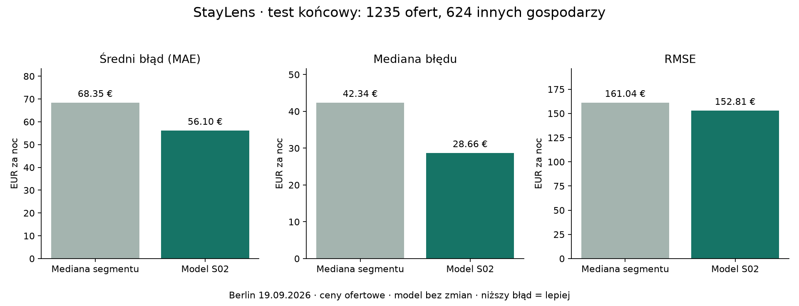

# StayLens — końcowa ocena modelu, 02.11.2026

Autor projektu: **Szymon Kawlowski, s29670**. Wybrany przed testem model S02 pozostaje bez zmian. Ten raport uzupełnia historyczne raporty S02–S04; ich wyniki walidacji pozostają poprawne i nie są wynikami testowymi.

## Wynik na odłożonym zbiorze

**1235 ofert, 624 gospodarzy** nieobecnych w train i validation. Ten sam snapshot Berlina, 19.09.2026, ceny ofertowe za noc w EUR.

| Metryka | Mediana segmentów | Wdrożony model S02 |
| --- | ---: | ---: |
| Średni błąd bezwzględny, MAE | 68,35 EUR | **56,10 EUR** |
| Mediana błędu bezwzględnego | 42,34 EUR | **28,66 EUR** |
| RMSE | 161,04 EUR | **152,81 EUR** |
| Błąd nie większy niż 20% ceny | 32,23% | **42,67%** |
| Błąd nie większy niż 30 EUR | 38,46% | **51,34%** |
| 90. percentyl błędu | 133,90 EUR | **104,15 EUR** |

Redukcja MAE wynosi **17,92%**, czyli 12,25 EUR. Sparowany bootstrap 1000 prób gospodarzy (seed 42), z MAE ważonym liczbą ofert, daje 95% przedział poprawy 8,93–15,67 EUR, względnie 12,80–23,93%. Jest to niepewność porównania na tej populacji, **nie przedział ceny konkretnej oferty**. Pełne agregaty: [test_evaluation.json](test_evaluation.json).

Wcześniejsze validation MAE wynosiło 53,61 EUR, CV 54,90 EUR. Zbliżony wynik testowy nie sugeruje dużego załamania jakości po przejściu do innych gospodarzy tego snapshotu. Nie dowodzi braku overfittingu w ogóle i nie jest sprawdzianem innych miast ani przyszłych terminów. Model pozostaje orientacyjnym odniesieniem cenowym.

## Ograniczenia widoczne w segmentach

| Rzeczywista cena za noc | Liczba ofert | MAE modelu |
| --- | ---: | ---: |
| Do 100 EUR | 441 | 24,05 EUR |
| Powyżej 100 do 200 EUR | 491 | 37,31 EUR |
| Powyżej 200 do 400 EUR | 237 | 63,95 EUR |
| Powyżej 400 EUR | 66 | **381,90 EUR** |

Cena rzeczywista jest znana dopiero przy ocenie. Te przedziały nie są dostępną z góry regułą kwalifikowania nowego formularza. W teście ceny dochodzą do 3837,63 EUR; nie usuwano drogich ani trudnych przypadków. Błędy skrajnych ofert silnie zwiększają MAE/RMSE.

Całe lokale: 947 ofert, MAE 61,38 EUR. Pokoje prywatne: 274, MAE 38,15 EUR. Pokoje hotelowe: tylko 12, MAE 46,96 EUR (baseline 41,30 EUR, czyli w tej małej grupie lepszy). Współdzielone: tylko 2, MAE 69,44 EUR. Nie wyciągamy mocnych wniosków dla tych małych prób. Trzy wiersze testowe mają komplet 18 cech identyczny z jakimś wierszem train; to nie dowód tożsamości nieruchomości. Pozostają w głównej ocenie, bez usuwania po poznaniu wyniku. Nie ma wspólnych identyfikatorów ofert ani gospodarzy między częściami.

## Kontrola procedury

- Zlecenie użytkownika i [protokół](../../configs/s05_final_protocol.json) zapisano przed odczytem testu. Commit `a0895abbe6e3d525c79662266df371ff71e9192e` zawiera protokół i skrypt oceny.
- Zachowano oryginalny podział SHA256 po gospodarzach oraz reguły ceny/lokalizacji. Train 5814/3114 gospodarzy, validation 1108/680, test 1235/624.
- Załadowano wyłącznie dwa zapisane w S02 modele: wybrany boosting i punkt odniesienia. **Zero fit, zero doboru parametrów, zero awansu kolejnego modelu**. Metody fit są dodatkowo blokowane podczas przewidywania.
- Sprawdzono hashe źródła, historycznego kodu, protokołu i wersje bibliotek. Wszystkie pliki oryginalnego katalogu S02 mają identyczne hashe przed i po ocenie.
- Model SHA256: `47ed42c9c8ccec4db103da7ec437ea240d5045191eaf20df9e9e4bd85265d7bf`.
- Zapisane przewidywania testowe z ID pozostają wyłącznie w ignorowanym `artifacts/s05-final/`. Nie trafią do repo, obrazu ani pakietu dla odbiorcy.
- [Niezależna kontrola](verification.json) przeliczyła sześć metryk z zapisanych przewidywań, bez ponownego wywołania modelu. Skrypt `verify_final_evaluation.py` odtwarza też wykres.
- Pierwsza ocena: `python scripts/run_final_evaluation.py --confirm-final-holdout`. Skrypt odmawia nadpisania istniejącego wyniku. To procedura historyczna, **nie uruchamiać ponownie w CI ani do strojenia**.

Oryginalny manifest S02 zachowuje `test_evaluated: false` jako zapis stanu z 28.10. Aktualne metadane produkcyjne i publiczny plik `final-evaluation.json` uzupełniają go wynikiem z 02.11; nie modyfikują modelu ani manifestu źródłowego. Komunikaty aplikacji rozróżniają validation i test.

Odbiór interfejsu i aktualnego wdrożenia: [ACCEPTANCE.md](ACCEPTANCE.md). Pakiet dla prowadzącego: [ZACZNIJ_TUTAJ.md](../../docs/oddanie/ZACZNIJ_TUTAJ.md).
